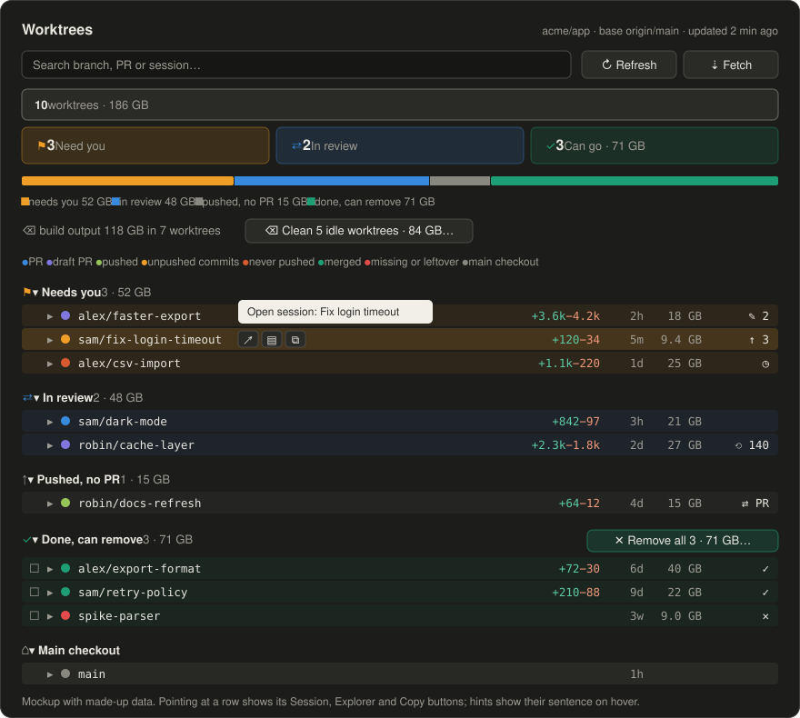

# Worktrees panel for Claude Code

A Claude Code pane for git worktrees: it groups them by what needs doing, shows PR status from Azure
DevOps or GitHub, the Claude sessions and disk use of each worktree, removes finished worktrees safely,
and cleans build output.



Every git worktree of the session's repository lands in one group:

- **Needs you**: uncommitted changes, unpushed commits, commits behind the remote, commits after a
  merged PR, or a session waiting for you
- **In review**: an open or draft PR
- **Pushed, no PR**: pushed without a PR, or detached
- **Done, can remove**: merged PR, no commits, or folder gone (folded by default)
- **Main checkout**

It also shows each worktree's disk use, removes finished worktrees safely, and can delete build output
that a build makes again.

**Requirements:** Windows with Windows PowerShell 5.1 (built in), git, and the Claude Code desktop app
for the session links. PR status comes from Azure DevOps or GitHub (see below); any other remote works
without it.

## Install

At the prompt of a terminal session:

```
/plugin install worktrees-panel --marketplace Tsacek/claude_worktrees_panel
```

From a shell: `claude plugin install worktrees-panel --marketplace Tsacek/claude_worktrees_panel`. In the desktop app:
click + next to the prompt box, then Plugins, Add marketplace with `Tsacek/claude_worktrees_panel`, then Add plugin.

## Use

- `/worktrees` opens the pane and refreshes if the data is older than a minute.
- The tiles at the top (Need you, In review, Can go, and the total) filter the list; the search box
  matches branch, worktree name, PR number or title and session titles. Click a group header to fold it.
- Each worktree is one line: a status dot (its label shows on hover; a legend above the list names the
  colors), branch, `+ins -del` since the branch-off from the base, last activity, disk size and the next
  step as a symbol and count (`✎ 2` commit, `↑ 3` push, `↓ 1` pull, `⟲ 140` rebase, `⇄ PR` open a PR,
  `✓` safe to remove; the sentence shows on hover). Click a line for the details: path, counts, the PR
  link, the sessions in that worktree and Copy path / Copy branch / Explorer / VS Code. Pointing at a
  line shows Session, Explorer and Copy buttons at its end.
- **↻ Refresh** re-reads local refs and measures every size again; **⇣ Fetch** runs
  `git fetch origin --prune` first. A progress bar shows how far a scan is; the old list stays until the
  new one arrives.
- **The widget** (on by default; the option is at the bottom of the pane) shows `2 need you`,
  `3 in review`, `6 can go · 41 GB` above the prompt of every session in a git repository.
- While the pane or widget is shown, it refreshes every 10 minutes. Sessions share the result through
  the mod's store, so only one of them runs the scan.

## Repository config

A repository can commit `.claude/worktrees-panel.json`, so that everyone working in it gets the same
behavior. Every key is optional:

```json
{
  "base": "main",
  "buildDirs": ["build/*/obj"],
  "binaryDirs": ["build/*/bin"],
  "beforeRemove": ["powershell.exe", "-File", "tools/unlink.ps1", "{path}"],
  "adoTokenName": "MyOrg-AzureDevOps-PAT"
}
```

| Key | Without it | What it does |
|---|---|---|
| `base` | the remote's default branch (`origin/HEAD`) | the branch line counts and "merged" are measured against |
| `buildDirs` | build cleaning is hidden | folders, relative to a worktree, that hold build output; `*` and `?` match within one folder name |
| `binaryDirs` | no binaries option | built binaries, deleted only when ticked in the clean dialog |
| `beforeRemove` | nothing runs | a command run from the main checkout before a worktree is removed; `{path}` is the worktree |
| `adoTokenName` | `worktrees-panel:ado:<organization>` | the Windows Credential Manager entry holding the Azure DevOps token |

The file is read from the checkout the session runs in, else from the main checkout, so a branch can
try changes to it before they are merged.

## PR status

The host comes from the `origin` remote URL:

- **Azure DevOps** (`dev.azure.com`, `*.visualstudio.com`, or their SSH forms): a personal access
  token with Code > Read, kept in Windows Credential Manager. When it is missing, refused or blocked,
  a card at the top of the pane says how to fix it; **Store token...** opens a window that asks for
  the token (hidden input), checks it and saves it. It never passes through the panel.
- **GitHub** (`github.com`): the GitHub CLI and its own sign-in (`gh auth login`); no token to store.
- **Anything else**: no PR data. A branch reaches Done only when it has no commits beyond the base, so a
  squash-merged branch is not recognized as merged.

## Removing worktrees

- **Remove all N...** on the Done group header, or tick worktrees and **Remove N selected...**.
  Worktrees with uncommitted changes, unpushed commits, commits after their merged PR, a session active
  in the last 15 minutes, the main checkout and the session's own worktree cannot be picked (the details
  say why).
- The dialog first checks each worktree with `scripts/remove-worktrees.ps1 -DryRun` and lists what will
  be removed or skipped, with the space it frees. Options: delete the local branches, discard edits
  inside submodules, archive their sessions.
- Removal runs the config's `beforeRemove`, then unlinks every junction and symlink inside the worktree
  without following it, and runs `git worktree remove`. `--force` is used only when git refuses because
  of submodules, after the check found nothing but ignored files to lose.

## Cleaning build output

With `buildDirs` in the config, the line under the disk bar shows the build output of all worktrees
and offers **Clean N idle worktrees** (no session active in the last 15 minutes, not this session's,
not the main checkout); a row's details offer **Clean build output** for that worktree alone. A folder
is deleted only when git ignores it and it is no link; links inside it are unlinked first.

## How it works

`scripts/collect.ps1` does the scan: git runs sequentially, the PR lookups in parallel, and branch-off
line counts are cached by commit pair in `%LOCALAPPDATA%\claude-worktrees-panel\stat-cache.json`.
Session data comes from the desktop app's session records under `%LOCALAPPDATA%\Claude-Data`; a session
opens through its `claude://` app link. `scripts/sizes.ps1` measures each worktree after a scan,
skipping junctions and symlinks; sizes are kept for an hour in the mod's store. The scripts report their
steps as `@progress <done> <total> <what>` lines on stderr, which the panel shows as progress bars.

## Development

- `claude plugin validate <folder>` and `claude plugin test <folder>` check the pane (`tests/panel.test.tsx`).
- `powershell -File tests/config.check.ps1` checks the remote URL parsing and the folder patterns.
- To work on the mod, clone this repository and start Claude Code with `--plugin-dir <clone>`.

## License

MIT, see [LICENSE](LICENSE).
